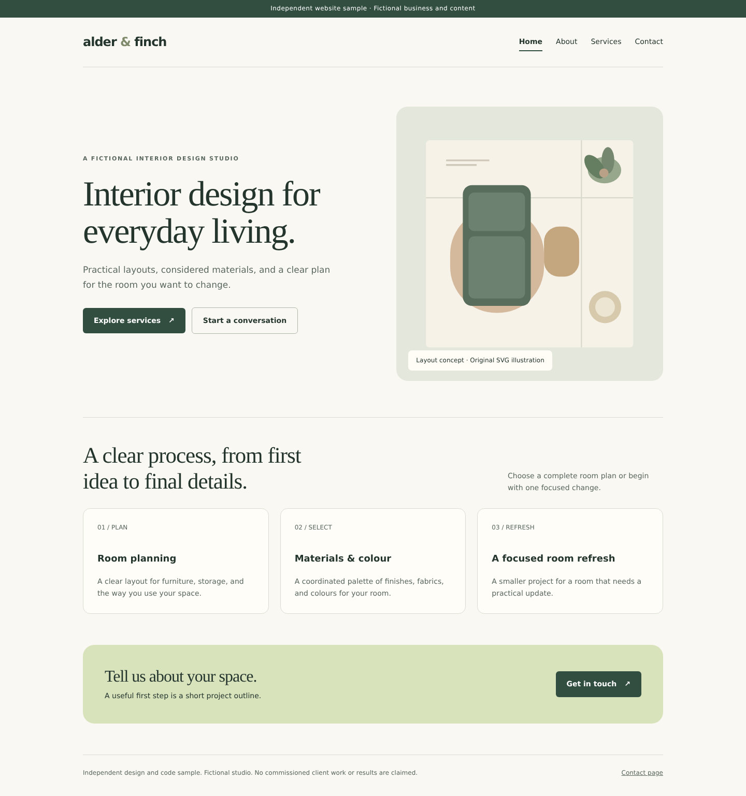

# Small business site sample

A responsive four-page brochure website built with plain HTML and CSS. Alder & Finch is fictional. This is independent sample work, not a client deployment.

Pages: Home, About, Services, Contact. The email link uses example.com. There is no form backend, analytics, external font request, CMS, payment flow, or third-party asset.

Run locally:

```sh
python3 -m http.server 8080
```

Open http://localhost:8080/. The navigation remains available on mobile, keyboard focus is visible, and reduced-motion preferences disable smooth scrolling.

The SVG room illustration is original code in index.html. All assets are local. Replace the fictional copy and demonstration email before client deployment.

## Preview



[Mobile preview](preview-mobile.png)

## Verified checks

Browser QA checked all four pages at widths of 360, 768 and 1440 pixels, with no horizontal overflow and visible navigation. Keyboard skip navigation, page links and the demonstration email link passed. `qa-results.json` records the exact checks. Live email delivery and client hosting are outside this sample.

The optional browser check script uses Playwright with an installed Chrome, or `SAMPLE_BROWSER_EXECUTABLE` when specified.
